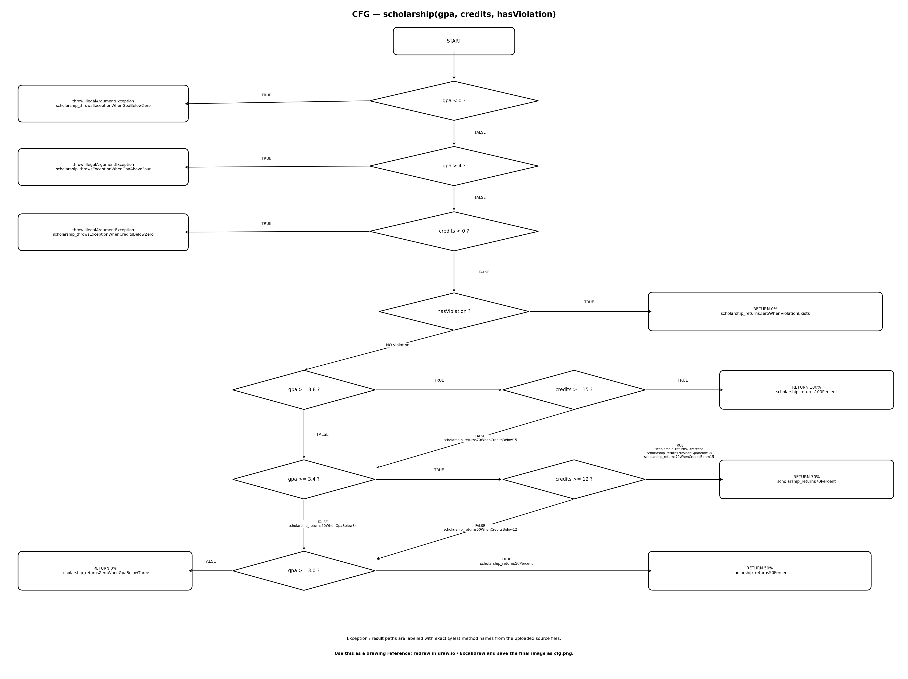

Нэр: Азтүшиг
Оюутны код: B232270014

Java version:

java version "23.0.2" 2025-01-21

Java(TM) SE Runtime Environment (build 23.0.2+7-58)

Java HotSpot(TM) 64-Bit Server VM (build 23.0.2+7-58, mixed mode, sharing)

mvn version:

Apache Maven 3.9.9 (8e8579a9e76f7d015ee5ec7bfcdc97d260186937)

Maven home: C:\\apache-maven-3.9.9

Java version: 23.0.2, vendor: Oracle Corporation, runtime: C:\\jdk-23.0.2

Default locale: en\_US, platform encoding: UTF-8

OS name: "windows 11", version: "10.0", arch: "amd64", family: "windows"

\## Хэсэг A - Happy Path Testing
ScholarshipCalculatorTest класст 5 happy path тест бичсэн.

Шалгасан функцүүд:

letterGrade_returnsA

letterGrade_returnsB

letterGrade_returnsC

gpa_calculatesAverageCorrectly

scholarship_returns100Percent

Coverage:

Line Coverage: 60.00%

Branch Coverage: 48.78%

Tests run: 5

Эхний тестүүдээр үндсэн амжилттай урсгалууд хамрагдсан боловч оролтын алдаатай нөхцөлүүд болон тэтгэлгийн бусад салаанууд бүрэн хамрагдаагүй байсан.

Үр дүн:

results/mvn-verify-A.txt

results/jacoco-A.csv

\## Хэсэг B - CFG ба Branch Coverage
Шалгасан нөхцөлүүд:

Онооны зөвшөөрөгдөх хязгаар.

GPA болон кредитийн буруу оролт.

GPA-ийн A, B, C, D, F салаанууд.

Сахилгын зөрчил.

Тэтгэлгийн 100%, 70%, 50%, 0%-ийн нөхцөлүүд.

&& болон || нөхцөлүүдийн тус тусын салаанууд.

scholarship() функцийн Control Flow Graph-ийг cfg.png файлд оруулсан. CFG-ийн ирмэг бүрд тухайн замыг шалгах тестийн method нэрийг тэмдэглэсэн.

Coverage:

Line Coverage: 100%

Branch Coverage: 100%

Tests run: 21

BRANCH_MISSED: 0

LINE_MISSED: 0

Үр дүн:

results/mvn-verify-B.txt

results/jacoco-B.csv

\## Хэсэг C — Давталтын зааг (0 / 1 / 2+)

`gpa()` доторх давталтад Лекц 9-ийн 0 / 1 / 2+ дүрмийг хэрэгжүүлсэн гурван төрлийн тест:

\- 0 удаа: `loop\_zero\_emptyArray\_throws` ба `loop\_zero\_nullArray\_throws` (хоёулаа assertThrows)

\- 1 удаа: `loop\_one\_singleScore` — gpa(\[95]) = 4.0

\- 2+ удаа: `loop\_many\_multipleScores` — gpa(\[95, 85, 75, 65]) = 2.5

Эдгээр тест хамралтын тоог өсгөөгүй, учир нь бүх мөр, салаа өмнөх тестүүдээр

аль хэдийн хамрагдсан байсан. Гэсэн ч хоосон, нэг элементтэй, олон элементтэй

массивт давталт өөр өөрөөр ажилладаг тул эдгээр гурван тохиолдол тусдаа

алдааг барьж чадна.

\## Хэсэг D — Хамралт 100% боловч алдаатай

ScholarshipCalculatorBoundaryTest класст дараах 7 хилийн утгыг шалгасан:

letterGrade_60_returnsD

letterGrade_59_99_returnsF

letterGrade_69_99_returnsD

letterGrade_zero_returnsF

letterGrade_100_returnsA

letterGrade_89_99_returnsB

letterGrade_90_returnsA

Эхний туршилтаар нийт 32 тестээс 1 тест амжилтгүй болсон.

Унасан тест:
ScholarshipCalculatorBoundaryTest.letterGrade_60_returnsD
expected: <D> but was: <F>

Алдааны шалтгаан нь ScholarshipCalculator.java доторх score > 60 нөхцөл байсан. Спецификацийн дагуу 60 оноо D үнэлгээнд багтах ёстой тул нөхцөлийг score >= 60 болгон зассан.

Эцсийн үр дүн:

Tests run: 32

Failures: 0

Errors: 0

Skipped: 0

Line Coverage: 100%

Branch Coverage: 100%

\### Дүгнэлт

Branch хамралт 100% байхад энэ алдаа үл үзэгдэгч байсан. Учир нь

`score > 60` ба `score >= 60` хоёр ижил үнэн, худал салааг үүсгэдэг бөгөөд

65, 30 гэх мэт онооны тест хоёр кодыг адилхан хамруулдаг. Хамралт нь кодын

мөр, салаа ажилласан эсэхийг хэмждэг боловч буцаасан утга спецификацитай

таарч байгааг хэмждэггүй. Яг 60 онооны зааг утгын тест л ялгааг илрүүлсэн.

Иймээс хамралт нь хэрэгтэй хэрэгсэл боловч зөв байхын хангалттай нотолгоо

биш болж таарсан, зааг утгын тест хэрэгтэй.

